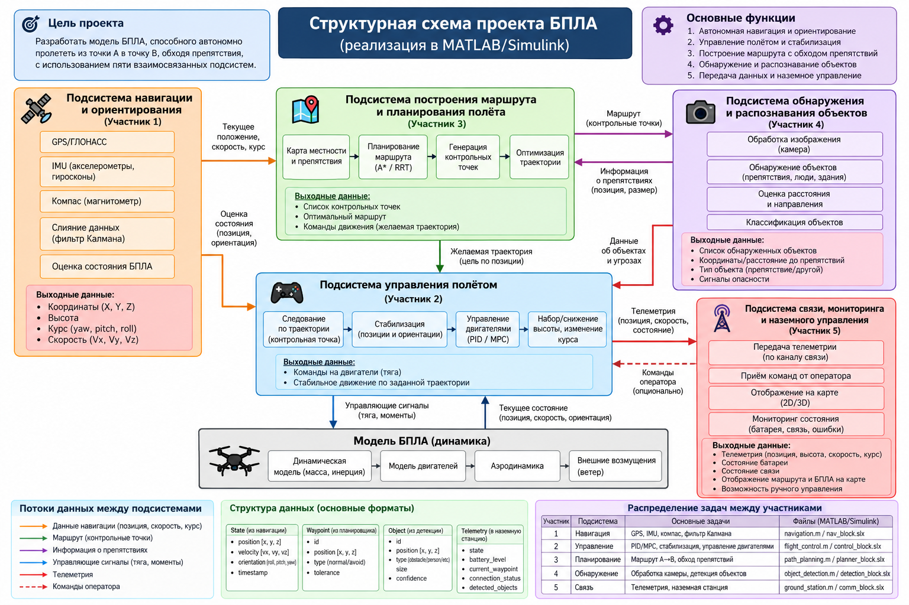

# UAV MATLAB / Simulink Team Project

Небольшой учебный проект по модельно-ориентированному проектированию БПЛА. Код разделён между **5 участниками**, но собирается в один общий продукт.

## Команда

| Участник | Подсистема |
|---|---|
| Ernesto Horserofl | Навигация и ориентирование |
| Иван Живоглядов | Управление полётом |
| Бодя Лемченко | Построение маршрута |
| Александр Лзедзей | Обнаружение объектов |
| Арсений Терехов | Связь и наземная станция |

Подробности: [`TEAM_ASSIGNMENTS.md`](TEAM_ASSIGNMENTS.md).



## Как устроен проект
- `team/` — пять персональных папок и пять основных MATLAB-функций;
- `simulate_uav.m` — интеграция подсистем;
- `config_uav.m` — общие параметры;
- `run_project.m` — единая точка запуска;
- `build_simulink_model.m` — создание обзорной модели Simulink;
- `tests/` — общие проверки;
- `docs/` — архитектура и интерфейсы;
- `bootstrap_github.ps1` — создание общего публичного GitHub repo и персональных веток.

## Запуск в MATLAB
Откройте корень проекта как Current Folder и выполните:

```matlab
run_project
```

Тесты:

```matlab
run('tests/run_tests.m')
```

Simulink:

```matlab
build_simulink_model
```

## Совместная работа
`main` — общий продукт. Каждый участник работает в своей ветке и своей папке, затем делает Pull Request в `main`.

Подробная инструкция: [`CONTRIBUTING.md`](CONTRIBUTING.md).

## Создать публичный GitHub-репозиторий
На Windows запустите:

```powershell
Set-ExecutionPolicy -Scope Process Bypass
.\bootstrap_github.ps1
```

Скрипт рассчитан на GitHub-владельца `1anchay` и имя репозитория `uav-matlab-team-project`.

> Для выдачи права записи нужны **GitHub usernames** участников. Обычных имён из ВК для этого недостаточно.
