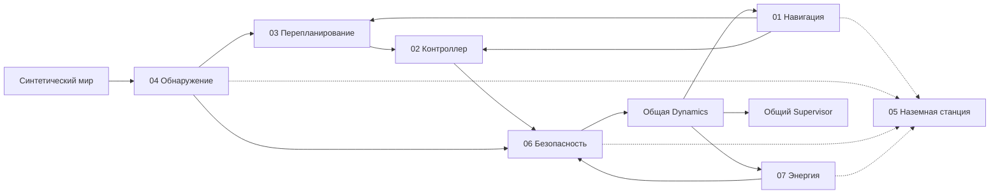

# Командный университетский проект
## Модульная система автономной навигации и управления учебным БПЛА в MATLAB / Simulink

*Технический отчёт · 7 участников · версия V3 (исследовательская ветка)*

### Аннотация

Разработан программный комплекс для учебного моделирования миссии беспилотного
летательного аппарата. Архитектура разделена на семь независимо разрабатываемых
подсистем: навигация, управление полётом, планирование маршрута, обнаружение
объектов, наземная станция, управление безопасностью и энергосистема.
Динамика БПЛА и контроль жизненного цикла миссии являются общими компонентами,
а не отдельными участниками команды.

Система эволюционировала от MATLAB-интегратора с рассчитанным заранее маршрутом
до **Advanced V2**, где синтетическое обнаружение неизвестного препятствия
запускает пересчёт маршрута *во время выполнения*. Для проверки Model-Based
Design дополнительно подготовлена **независимая V3 Simulink-схема** с
семью исполняемыми Model Reference, общей динамикой и супервизором.

> **Важный статус:** результаты V2 действительно получены в MATLAB Online и
> подтверждены пользовательскими логами. V3 — новый код и генератор моделей,
> их успешное выполнение в MATLAB Online **ещё предстоит подтвердить**.
> Нельзя представлять скриншоты V2 как проверку V3.

### 1. Постановка задачи

Требуется достигать заданной точки на карте, учитывать известные и новые
круговые препятствия, применять ограничения движения, отслеживать энергию и
передавать диагностические данные наземной станции. В специальных испытаниях
имитируются потери GPS, радиосвязи, критический заряд и неизвестные объекты.

**Граница применимости:** это учебная математическая и программная симуляция,
не готовый автопилот. В MATLAB V2 хранится позиция XYZ, но препятствия
описываются окружностями в XY. Simulink V3 — ещё более упрощённая 2D
динамика материальной точки. Нет ветра, аэродинамики, вращательной динамики,
физических сенсоров и реальных испытаний.

### 2. Архитектура Model-Based Design

Преподаватель предоставил таблицу сравнения Virtual/Atomic Subsystem,
Subsystem Reference и Model Reference. Важное для нашей команды преимущество
Model Reference — **раздельные файлы**, независимые точки интеграции,
параллельная разработка и возможность строить тестовый стенд для каждой модели.
Недостатки — дополнительная сложность настройки и необходимость следить
за совместимостью портов и дискретных состояний.

| № | Разработчик | Подсистема | Обязанность |
|---|---|---|---|
| 01 | Эрнест Карпухин | Навигация | Оценка положения, качества GPS, деградация |
| 02 | Иван Живоглядов | Управление | Целевые скорости, ускорение, ограничения |
| 03 | Богдан Лемченко | Планирование | Waypoint и перепланирование при открытии объектов |
| 04 | Александр Дзедзей | Обнаружение | Дальность, наблюдаемость и карта препятствий |
| 05 | Арсений Терехов | Наземная станция | Пакеты, потери, задержки, телеметрия |
| 06 | Артём Пучков | Безопасность | Аварийные ограничения, проверка сближения |
| 07 | Иван Касимов | Энергосистема | Расход, остаток и оценка резерва |

Базовый сигнальный контур:



Для исключения алгебраических циклов в Simulink используется дискретная
задержка состояния; каждый вход имеет фиксированные размеры. V3 применяет
именованные потоки Goto/From, чтобы уменьшить пересечения линий.

### 3. Математические модели

Управление формируется на основе ошибки позиции и скорости:

```text
e_p = target - position
v_d = saturation(k_p · e_p, v_limit)
a   = saturation(k_v · (v_d - velocity), a_limit)
```

Дискретная динамика 2D точки массы условно равна:

```text
velocity(k+1) = clamp(velocity(k) + acceleration(k) · dt, v_limit)
position(k+1) = position(k) + velocity(k+1) · dt
battery(k+1)  = max(0, battery(k) - drain(k) · dt)
```

В обнаружении кругов использована геометрия границы:
`d = ||center - position|| - radius`. Проверки избегают только
пересечения круга, а не доказывают безопасность для непрерывной физики БПЛА.
В более строгом MATLAB-интеграторе проверяется также пересечение отрезка
между соседними дискретными шагами.

**Online route planning в Advanced V2:** сенсор добавляет ранее неизвестное
препятствие в известную карту; планировщик пересчитывает маршрут от текущей
оценки положения до цели, проверяя каждый сегмент на допустимый зазор.
Маршрут может изменяться в ходе одной миссии.

**Новая V3:** отдельный MATLAB Function-планировщик Simulink хранит
известные круги в фиксированном массиве и выбирает промежуточную точку
обхода. Это более простая эвристика, **не точное повторение** V2.

### 4. Подтверждённые результаты MATLAB Online

| Метод проверки | Наблюдаемый результат |
|---|---|
| Основные MATLAB-модули | 11/11 PASS |
| Детерминированные системные сценарии | 4/4 PASS |
| Поведенческие сценарии Safety | 4/4 PASS |
| Mission Lifecycle unit tests | 6/6 PASS |
| Monte Carlo исходной системы | 10/10 GOAL_REACHED |
| Исполняемая 2D Simulink-архитектура | [A]–[D] PASS |
| Новая MATLAB Advanced V2 | 13/13 PASS |
| Приёмка кампании Advanced V2 | 6/6 PASS |

Параметры измеренной **V2 миссии с одним неизвестным препятствием**:

| Показатель | Значение |
|---|---:|
| Время до достижения цели | 23,10 с |
| Ошибка до цели | 0,13 м |
| Обнаруженные неизвестные препятствия | 1 |
| Онлайн-перепланирования | 1 |
| Минимальный зазор до границы круга | 9,39 м |
| RMSE навигации | 0,171 м |
| Доставка телеметрии | 96,1 % |
| Остаток батареи | 96,46 % |

В случае `two_unknown` зафиксированы **два** пересчёта маршрута и
`GOAL_REACHED` с минимальным зазором **9,11 м** за 24,3 с.

Шестой сценарий кампании — `critical_battery` — корректно завершился
`LOW_BATTERY` при времени 0. Поэтому **5/6 достигли цели, но 6/6
выполнили соответствующий ожидаемый сценарий**.

Действовавшая ранее функциональная Simulink-модель с Mission Supervisor
завершила номинальную миссию на **19,80 с** с терминальным кодом 1.
В отдельном случае неизвестного объекта защита вмешалась **50 шагов**,
минимальный зазор составил **2,66 м**. Эти метрики относятся именно
к прежней Simulink-версии, не к новому V3.

### 5. Воспроизводимость и проверка

- Чёткие параметры находятся в `config_uav.m` и `advanced_config.m`.
- По возможности фиксируются seed для шума и пропусков пакетов.
- Результаты миссии доступны как MATLAB-переменные и CSV/Markdown.
- `.github/workflows/matlab-regression.yml` запускает MATLAB-тесты
  на Pull Request; ранее зафиксирован успешный CI-прогон базовой V2.
- Для V3 добавлены **новые** тесты: шесть блоков unit-тестов,
  четыре этапа интеграционной Simulink-проверки.
- Отдельное исследование устойчивости варьирует вероятность
  пропущенных обнаружений, сохраняет также **неудачные** исходы и
  не выводит ложных обещаний безопасности.

### 6. Ограничения и корректность выводов

Результаты относятся к ограниченному набору моделируемых карт, параметров,
seed и условий. Нельзя делать вывод о вероятности безотказного реального
полёта, устойчивости к ветру или проверке аппаратных систем. Результат
реактивного обхода одного круга не распространяется на динамические объекты.

Новый V3 Simulink — исследовательский этап, который ещё нужно прогнать в
MATLAB Online. CI базовой V2 не означает прохождения V3.

### 7. Дальнейшие исследования

1. Выполнить приёмку нового V3 Model Reference-прототипа.
2. Сравнить V2 MATLAB и V3 Simulink на **разных уровнях абстракции**,
   не требуя совпадения траекторий при разных алгоритмах.
3. Изучить систематические пропуски сенсора, плотные карты, ложные детекции,
   GPS outage и зависимость времени исполнения от сложности.
4. При наличии времени создать 3D динамику квадрокоптера с наклоном,
   тягой, PID-каскадами и физически осмысленным энергопотреблением.
5. Сохранить проверенные бинарные `.slx`, отчёты и скриншоты в GitHub
   после ревью каждого из семи участников.

### Источники проекта

- Собственные исходные файлы `team/*`, `simulate_uav.m`,
  `simulate_advanced_uav.m`, `build_functional_simulink_model.m`.
- Журнал испытаний `docs/VERIFICATION_STATUS.md`.
- Таблица **Component Summary**, предоставленная преподавателем
  (сравнение возможностей Subsystem и Model Reference).
- Материалы по архитектуре `docs/TEAM_INTERACTION.md`,
  `docs/INTERFACES.md` и новые требования `docs/V3_REQUIREMENTS.md`.

*Отчёт пригоден как инженерный черновик к защите; команда должна указать
университет, дисциплину, научного руководителя, собственный вклад и
официальную библиографию согласно требованиям преподавателя.*
