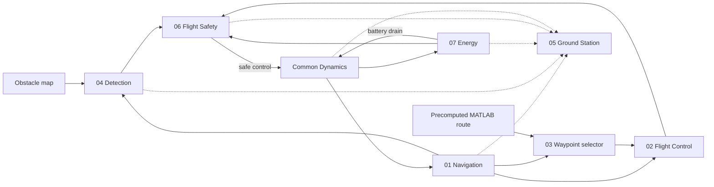

# Архитектура UAV — 7 разработчиков и общая динамика

Проект хранит **два разных уровня моделирования**, не подменяя один другим.

## 1. Основная MATLAB-симуляция (XYZ)

`run_project.m` → `simulate_uav.m` → семь `team/NN_Фамилия_Имя/subsystem_*.m`. Она реализует более полную учебную интеграцию и прошла 11/11 тестов в MATLAB Online по предоставленному логу.

## 2. Обзорная Simulink-схема (Model Reference, заглушки)

`build_component_models.m` + `build_simulink_model.m` создают `UAV_Team_Model.slx` с восемью блоками-ссылками: семь участников и Dynamics. Функции MATLAB внутри этих схем **не выполняются**. Архитектура успешно прошла smoke test в MATLAB Online.

## 3. Новый функциональный Simulink-прототип (XY)

`build_functional_simulink_model.m` создаёт **новые** модели `UAVF_*.slx` и `UAVF_Team_Model.slx`. В каждой из семи независимых моделей находятся MATLAB Function-блоки с рабочими алгоритмами. Общая динамика — отдельный Model Reference с `Unit Delay`.

Сигналы фиксированной размерности: `state=[x;y;vx;vy;battery]`, `nav=[x;y;vx;vy]`, `target=[x;y]`, `control=[ax;ay]`, `detection=[distance;dx;dy;radius]`, `energy=[drain;battery;lowFlag]`, `telemetry=[x;y;vx;vy;battery;distance;safetyCode]`.

Маршрут создаётся MATLAB-планировщиком **до запуска**; в Simulink блок №03 только переключает цель. Это **2D-прототип с упрощённой физикой**, не полноценная 3D-аэродинамика и не проверенный физический БПЛА. См. [models/functional/README.md](../models/functional/README.md).

## 4. Ответственные

| № | Модуль | Участник |
|---|---|---|
| 01 | Навигация | Эрнест Карпухин |
| 02 | Управление полётом | Иван Живоглядов |
| 03 | Планирование и waypoint | Богдан Лемченко |
| 04 | Обнаружение объектов | Александр Дзедзей |
| 05 | Телеметрия | Арсений Терехов |
| 06 | Безопасность | Артём Пучков |
| 07 | Энергосистема | Иван Касимов |

**Dynamics** — общий компонент, не отдельный участник. Основные требования и проверки: [REQUIREMENTS_AND_TESTS.md](REQUIREMENTS_AND_TESTS.md). Изображения и схемы преподавателя по Model-Based Design использованы как обоснование независимых Model Reference и регулярной верификации.
