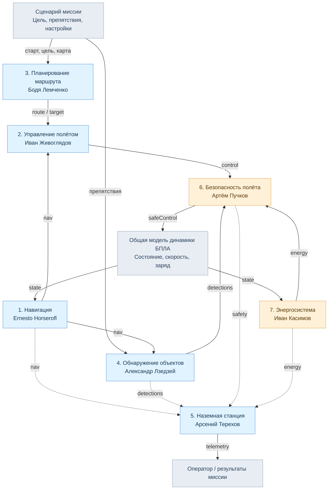

# Схема взаимодействия 7 модулей БПЛА

**Назначение:** показать преподавателю, что у каждого из семи участников своя функциональная подсистема с определёнными входами и выходами. **Общая модель динамики** — вспомогательная часть проекта, а не восьмой участник.

## Порядок работы в коде

1. `run_project.m` готовит сценарий. Модуль №3 строит маршрут **один раз перед симуляцией**.
2. На каждом шаге `simulate_uav.m`: №1 получает навигационную оценку; №4 определяет видимые препятствия; №2 рассчитывает команду движения к очередной точке.
3. №7 определяет темп расхода и прогноз заряда.
4. №6 проверяет команду, близость препятствий и сигналы энергосистемы; формирует `safeControl` и статус `safety`.
5. №5 формирует телеметрию из навигации, состояния, скорректированной команды и статусов №6/№7.
6. Общая модель динамики интегрирует движение и расход батареи, обновляя состояние для следующего шага.

**Легенда:** сплошные стрелки — расчётные и управляющие данные; пунктир — мониторинг/телеметрия. Работа реализована в учебной MATLAB-симуляции. Команда `build_simulink_model` строит отдельную обзорную блок-схему (не исполняет математическую симуляцию).
